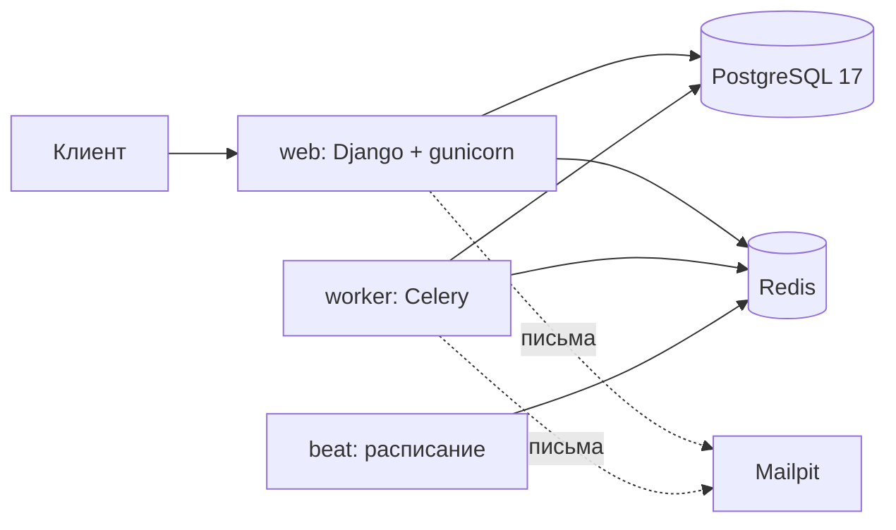

# Архитектура

## Сервисы (docker-compose)



Эмулятор шлюза (`payments`) и его рассыльщик вебхуков (`payments-sender`) добавятся в КТ-4. С основным проектом они общаются только по HTTP.

## Модули и зависимости

Зависимости идут только вниз (раздел 3 ТЗ), проверяет `scripts/check_layers.sh`:

```
reports       → catalog, sales, ledger, organizations
checkin       → sales, organizations
payments      → sales, ledger, notifications
sales         → catalog, organizations, notifications
catalog       → organizations, notifications
organizations → accounts, notifications
accounts      → notifications
ledger        → никого
notifications → никого
```

От `common` (ошибки, идемпотентность, request id, outbox) может зависеть любой модуль; `common` не зависит от модулей проекта.

## Порядок захвата блокировок

Единый порядок на весь проект. Любая транзакция берёт блокировки только в этом порядке, иначе две транзакции ловят взаимную блокировку (deadlock).

> Черновик, окончательно фиксируется в КТ-3 вместе с ADR о блокировках.

1. Пара «покупатель + мероприятие» (лимит 6 билетов, один неоплаченный заказ).
2. Строка `PromoCode`.
3. Строки `StandingInventory` по возрастанию id.
4. Строка `EventQueue` (горячая: транзакция вокруг неё короткая).

Места (`seated`) блокировок не требуют: их защищает частичный уникальный индекс.

## Запросы к внешним системам

Ни одного HTTP-вызова внутри открытой транзакции: сначала намерение пишется в БД и коммитится, затем идёт вызов, результат записывается второй транзакцией.
